# Machine Learning with Python | Learning Portfolio

A collection of practical Python, data analysis, and machine learning projects documenting progressive learning through hands-on implementation, experimentation, and model evaluation.

The portfolio emphasizes reproducible workflows, appropriate model validation, transparent interpretation, and responsible application of predictive analytics, including examples relevant to disease surveillance and public health.

## Learning Projects

Projects are organized chronologically in the [`lessons/`](lessons/) directory.

| Lesson | Topic | Project |
|:---:|---|---|
| 02 | Python Foundations | [View Python Script](lessons/lesson_02.py) |
| 03 | Data Analysis with pandas | [View Python Script](lessons/lesson_03_pandas.py) |
| 05 | Classification and Model Evaluation | [View Notebook](lessons/lesson_05_classification.ipynb) |
| 09 | Imbalanced Classification | [View Notebook](lessons/lesson_09_imbalanced_data.ipynb) |
| 12 | Machine Learning Pipelines | [View Notebook](lessons/lesson_12_ml_pipelines.ipynb) |
| 13 | Model Interpretability and Explainable AI | [View Notebook](lessons/lesson_13_model_interpretability.ipynb) |
| 14 | Model Calibration and Probability Reliability | [View Notebook](lessons/lesson_14_model_calibration.ipynb) |
| 15 | Advanced Classifiers: Gradient Boosting and SVM | [View Notebook](lessons/lesson_15_advanced_classifiers.ipynb) |
| 16 | Regression on Real Data | [View Notebook](lessons/lesson_16_regression.ipynb) |
| 17 | Outbreak Surveillance Analytics with OLAP SQL | [View Notebook](lessons/lesson_17_surveillance_olap.ipynb) · [Live Dashboard](https://axeln-da.github.io/Machine-Learning-python-portfolio-AN_DA/surveillance_dashboard.html) |
| 18 | Clustering Health Areas by Epidemic Profile | [View Notebook](lessons/lesson_18_clustering_health_areas.ipynb) · [Interactive Map](https://axeln-da.github.io/Machine-Learning-python-portfolio-AN_DA/health_area_clusters.html) |
| 19 | Forecasting for Surveillance and Emergency Response | [View Notebook](lessons/lesson_19_surveillance_forecasting.ipynb) · [Live Forecast](https://axeln-da.github.io/Machine-Learning-python-portfolio-AN_DA/forecast_outlook.html) |

*The table lists available, documented lesson files. Lesson numbering follows the original learning sequence.*

## Featured: Outbreak Surveillance Dashboard

Interactive dashboard built from OLAP SQL queries: KPI cards, the epidemic curve with a 7-day moving average, attack rates, reporting delays and weekly incidence by district. **[Open the live dashboard](https://axeln-da.github.io/Machine-Learning-python-portfolio-AN_DA/surveillance_dashboard.html)** (hover for details).

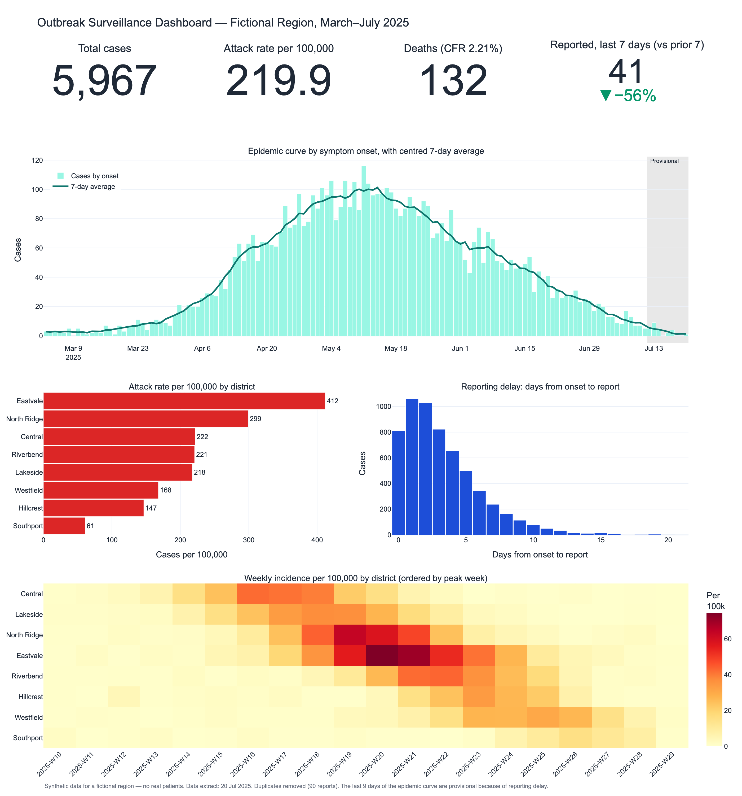

## Key Findings

| Lesson | Finding |
|:---:|---|
| 05 | Logistic Regression outperformed Random Forest (98.25% vs 95.61% test accuracy; 1 vs 3 missed malignancies). A cost-based threshold selected on training folds only removed every missed case, at the cost of 13 additional false alarms. |
| 09 | SMOTE, applied inside the pipeline to training folds only, raised minority-class recall from 30% to 75% but reduced precision from 67% to 23%; average precision was unchanged (0.51). |
| 12 | Supervised feature selection (SelectKBest, k = 8) matched the full model in cross-validation (AP 0.72), while PCA to 8 components lost the predictive signal (AP 0.19). |
| 13 | Logistic Regression achieved the best cross-validated PR-AUC of three models (0.53). SHAP contributions reproduced the model's predicted probability exactly; animal exposure and fever had the largest effects (odds ratios 5.4 and 4.0). |
| 14 | The model was already well calibrated (ECE 0.044); sigmoid and isotonic recalibration did not improve the Brier score. |
| 15 | On a real clinical dataset (768 patients), tuned Gradient Boosting, SVMs and Logistic Regression were statistically indistinguishable (test ROC-AUC 0.807–0.825; Gradient Boosting − Logistic Regression +0.013, 95% CI −0.011 to +0.037), and tuning pushed every model toward simplicity. A screening threshold chosen on training data raised test sensitivity from 0.556 to 0.889, cutting missed cases from 24 to 6. |
| 16 | On 1,460 Ames home sales, three very large homes caused 77.6% of squared error and collapsed one cross-validation fold; applying the dataset author's 4,000 sq ft scope rule raised Lasso R² from 0.636 to 0.931. XGBoost, LightGBM and scikit-learn Gradient Boosting performed almost identically, with XGBoost and LightGBM about 4× faster. Averaging Lasso and LightGBM gave the best test result (MAE $13,749, R² 0.931), though its edge over Lasso alone was not statistically confirmed. |
| 17 | A synthetic outbreak line list (6,057 reports) was modelled as a star schema and analysed with OLAP SQL in DuckDB. Data-quality checks removed 90 duplicate reports and flagged 30 impossible dates. A calendar dimension kept zero-case days in 7-day moving averages; reports averaged 92 on Mondays vs 17 on weekends, an artefact the trailing average removes. ROLLUP and CUBE produced district, province and regional attack rates (Eastvale 412 vs 220 per 100,000 regionally), and LAG-based week-over-week growth showed the slowdown before each district's peak. |
| 18 | Sixty health areas were profiled with SQL (attack rate, timing, duration, age, severity, reporting delay) and clustered with K-means. k = 4 was chosen over the silhouette optimum (k = 3) because k = 3 merged operationally different outbreaks. Hierarchical clustering agreed (ARI 0.948), the clusters recovered the hidden patterns (ARI 0.914; 58 of 60 areas) and were stable under resampling (median ARI 0.954). Without using coordinates, the clusters formed geographic rings: early surges 10 km from the town centre, late, more severe waves 40 km out. |
| 19 | Nowcasting corrected a 55% undercount in the latest week to within 2% of the eventual total. WHO-style thresholds (mean + 2 SD, 2-week alert rule) detected a post-flood outbreak in its first week (1,992 excess cases). In rolling-origin evaluation, a seasonal Poisson model was best in a normal year (37% skill over a naive baseline) but 18% worse than naive during the outbreak, with 95% ranges covering only 76%; an ensemble beat the baseline in both years and had the best weighted interval score in 2025. |

## Selected Figures

| SHAP feature importance | Precision–recall comparison | PCA explained variance |
|:---:|:---:|:---:|
| 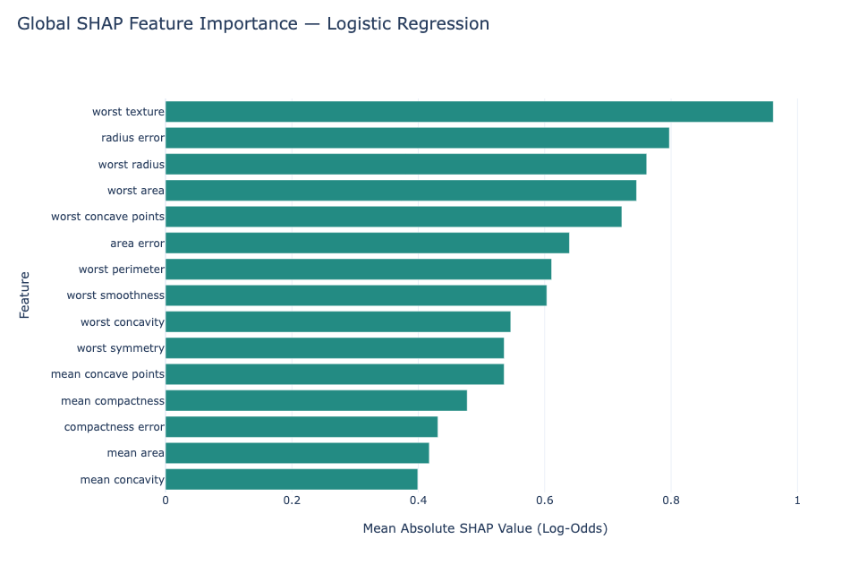 | 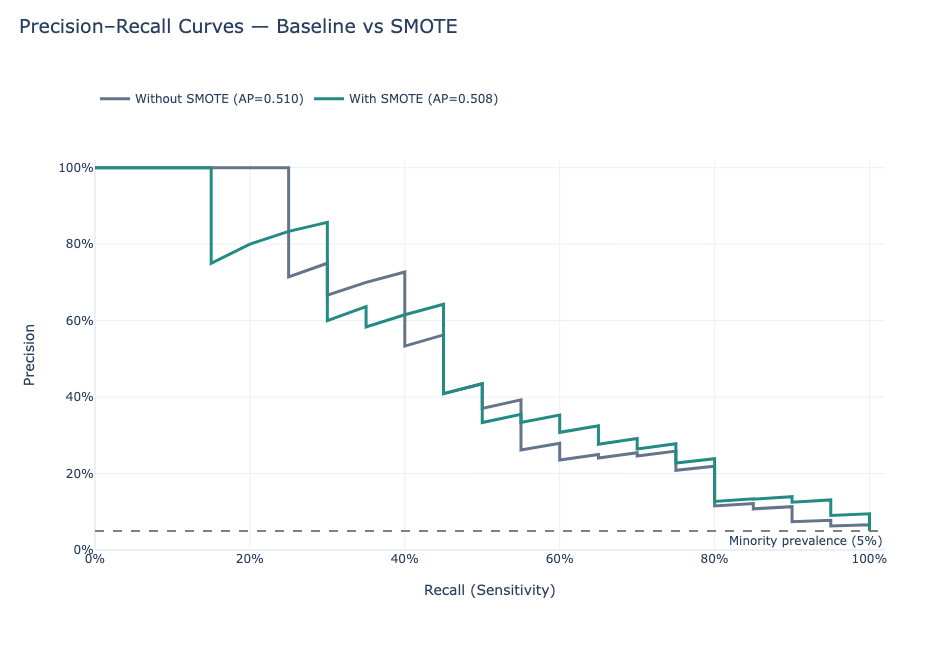 | 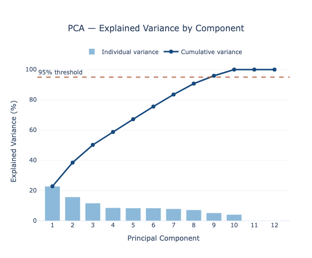 |

| Gradient boosting: learning rate vs number of trees | Test ROC-AUC with 95% bootstrap CIs |
|:---:|:---:|
| 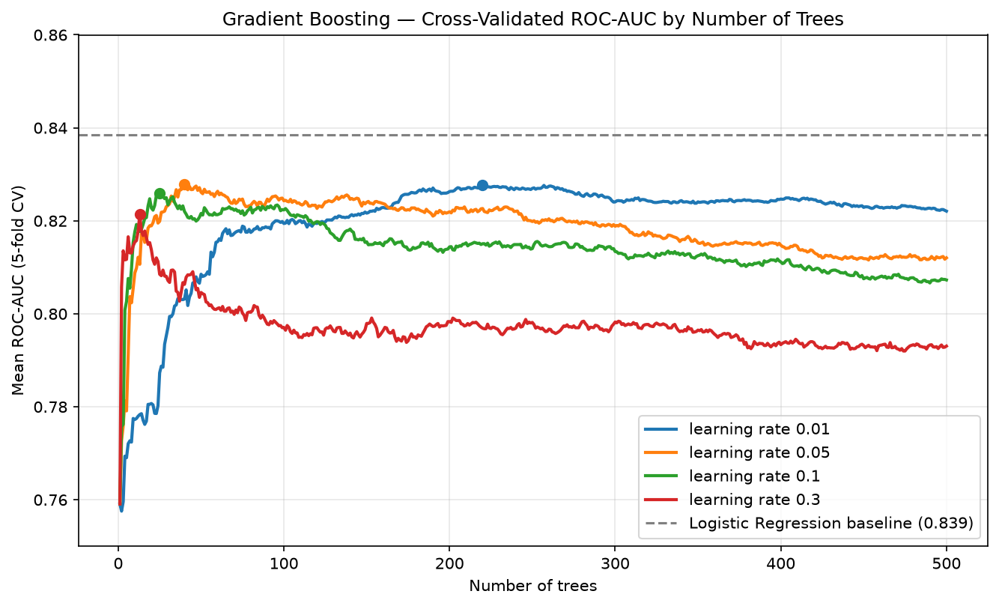 | 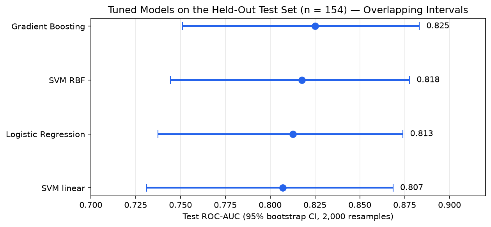 |

| Outlier diagnosis and model scope | Residual analysis by price band |
|:---:|:---:|
| 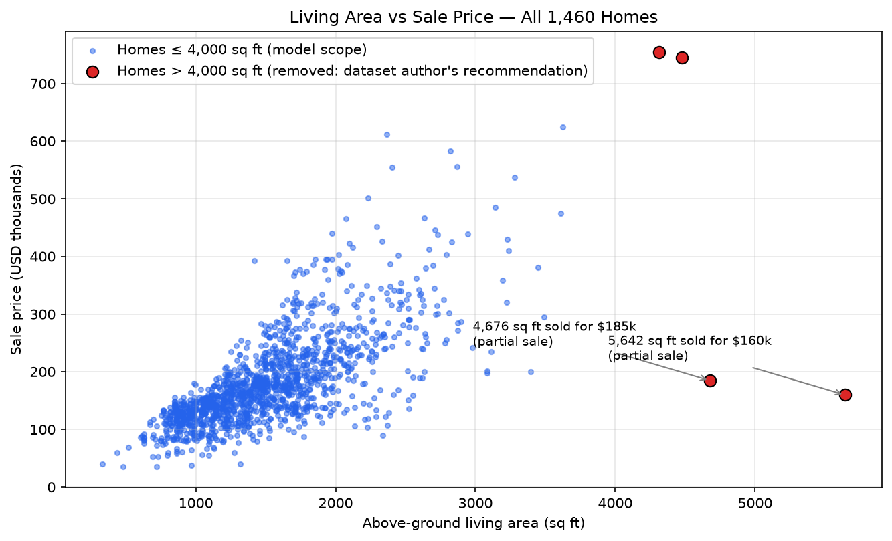 | 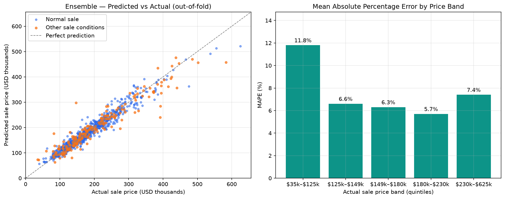 |

| Cluster profiles | Cluster separation and map |
|:---:|:---:|
| 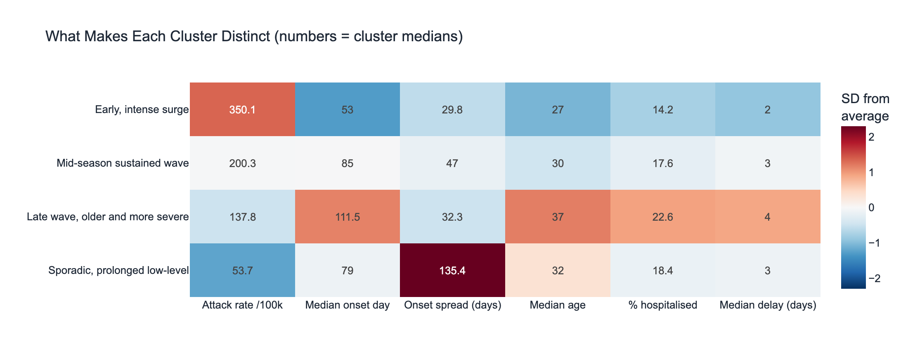 | 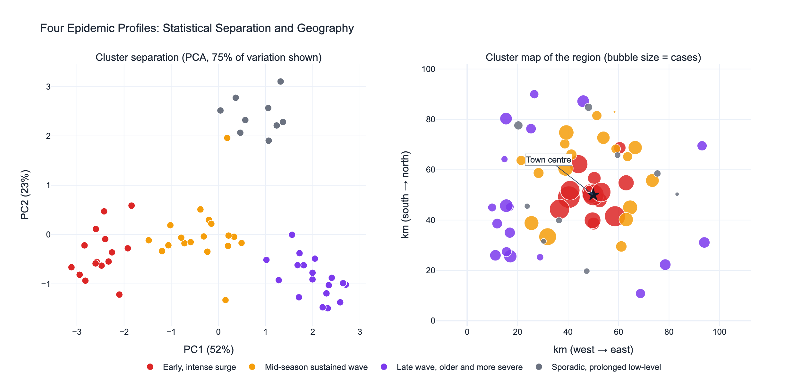 |

| Early warning: 2025 against the epidemic threshold | 4-week forecast with uncertainty |
|:---:|:---:|
| 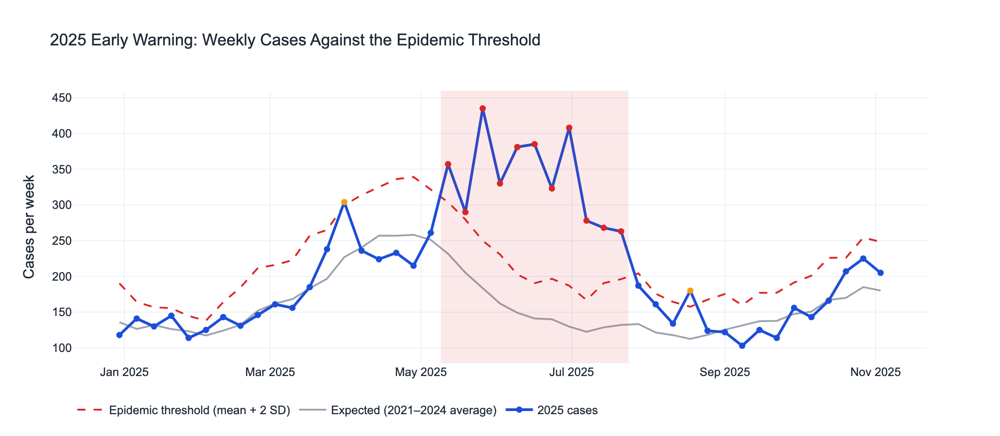 | 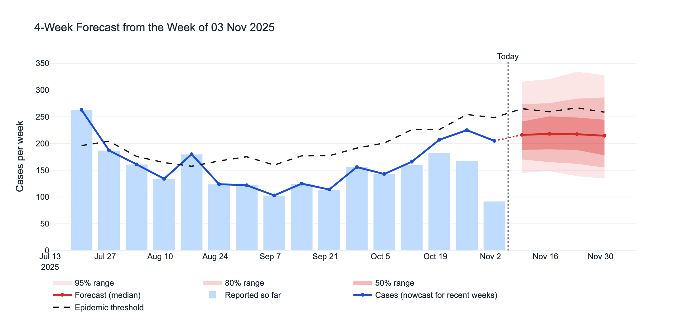 |

## How to Run

```bash
git clone https://github.com/axeln-DA/Machine-Learning-python-portfolio-AN_DA.git
cd Machine-Learning-python-portfolio-AN_DA
python -m venv .venv
source .venv/bin/activate
pip install -r requirements.txt
```

Notebooks run top to bottom with fixed random seeds (`random_state=42`). Tested with Python 3.14.

On macOS, XGBoost and LightGBM also need the OpenMP runtime (`libomp`). On Intel Macs, where Homebrew is no longer supported, it can be installed from [mac.r-project.org/openmp](https://mac.r-project.org/openmp/).

## Areas of Practice

- Python programming, pandas, and data preparation
- Exploratory data analysis and visualization
- Classification using Logistic Regression, Random Forest, Gradient Boosting, and Support Vector Machines
- Cross-validation and hyperparameter tuning
- Randomized hyperparameter search and early stopping
- Bootstrap confidence intervals and screening thresholds
- Regression with regularisation (Ridge, Lasso), residual analysis and outlier diagnosis
- Mixed-type preprocessing with ColumnTransformer and structural missing values
- Boosting libraries (AdaBoost, XGBoost, LightGBM) and model ensembling
- OLAP SQL on a star schema (DuckDB): window functions, ROLLUP/CUBE, QUALIFY deduplication
- Outbreak surveillance indicators: epidemic curves, 7-day moving averages, attack rates, week-over-week growth and reporting delays
- Interactive dashboards with Plotly, published with GitHub Pages
- Unsupervised learning: K-means, hierarchical clustering, choosing k, PCA, cluster validation and stability
- Surveillance forecasting: nowcasting reporting delays, epidemic thresholds, rolling-origin evaluation, prediction intervals, weighted interval score and ensembles
- Confusion matrices, ROC-AUC, and precision-recall evaluation
- Class imbalance, resampling, and feature selection
- Principal Component Analysis
- Machine learning pipelines
- Model interpretability and explainable AI
- Probability calibration and reliability assessment

## Tools and Libraries

Python, Jupyter Notebook, VS Code, NumPy, pandas, scikit-learn, imbalanced-learn, SHAP, XGBoost, LightGBM, joblib, DuckDB (SQL), Parquet, Matplotlib, and Plotly.

## Repository Structure

- [`lessons/`](lessons/) — Numbered Python scripts and Jupyter notebooks
- [`figures/`](figures/) — Selected visualizations from learning projects
- `README.md` — Portfolio overview and chronological project index

## Data and Limitations

Projects use educational datasets, including scikit-learn datasets, a public clinical dataset from OpenML (Pima Indians Diabetes, Ames Housing), and synthetically generated data, including fictional outbreak line lists and a weekly surveillance series.

Results are intended to demonstrate machine learning methods and analytical reasoning. Synthetic surveillance examples do not constitute validated clinical or operational prediction systems.

## Purpose

This repository documents ongoing professional development in Python, data science, and machine learning, with an emphasis on reproducible analysis, reliable evaluation, and interpretable predictive models.
