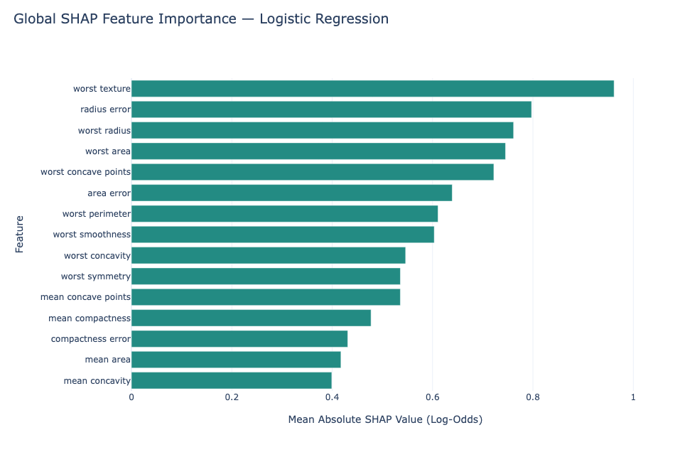
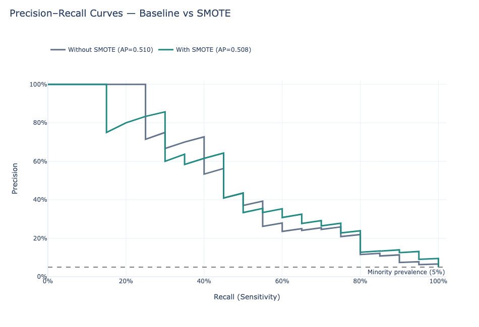
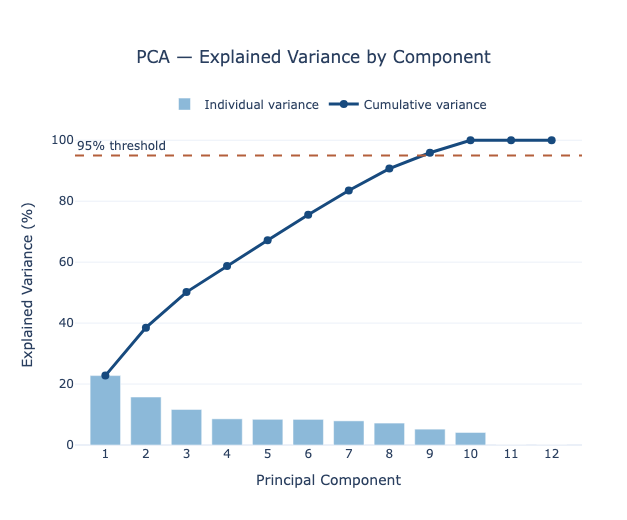

# Machine Learning with Python | Learning Portfolio

A collection of practical Python, data analysis, and machine learning projects documenting progressive learning through hands-on implementation, experimentation, and model evaluation.

The portfolio emphasizes reproducible workflows, appropriate model validation, transparent interpretation, and responsible application of predictive analytics, including examples relevant to disease surveillance and public health.

## Learning Projects

Projects are organized chronologically in the [`lessons/`](lessons/) directory.

| Lesson | Topic | Project |
|:---:|---|---|
| 02 | Python Foundations | [View Python Script](lessons/lesson_02.py) |
| 03 | Data Analysis with pandas | [View Python Script](lessons/lesson_03_pandas.py) |
| 05 | Classification and Model Evaluation | [View Notebook](lessons/lesson_05_classification.ipynb) |
| 09 | Imbalanced Classification | [View Notebook](lessons/lesson_09_imbalanced_data.ipynb) |
| 12 | Machine Learning Pipelines | [View Notebook](lessons/lesson_12_ml_pipelines.ipynb) |
| 13 | Model Interpretability and Explainable AI | [View Notebook](lessons/lesson_13_model_interpretability.ipynb) |
| 14 | Model Calibration and Probability Reliability | [View Notebook](lessons/lesson_14_model_calibration.ipynb) |

*The table lists available, documented lesson files. Lesson numbering follows the original learning sequence.*
## Key Findings

| Lesson | Finding |
|:---:|---|
| 05 | Logistic Regression outperformed Random Forest (98.25% vs 95.61% test accuracy; 1 vs 3 missed malignancies). A cost-based threshold selected on training folds only removed every missed case, at the cost of 13 additional false alarms. |
| 09 | SMOTE, applied inside the pipeline to training folds only, raised minority-class recall from 30% to 75% but reduced precision from 67% to 23%; average precision was unchanged (0.51). |
| 12 | Supervised feature selection (SelectKBest, k = 8) matched the full model in cross-validation (AP 0.72), while PCA to 8 components lost the predictive signal (AP 0.19). |
| 13 | Logistic Regression achieved the best cross-validated PR-AUC of three models (0.53). SHAP contributions reproduced the model's predicted probability exactly; animal exposure and fever had the largest effects (odds ratios 5.4 and 4.0). |
| 14 | The model was already well calibrated (ECE 0.044); sigmoid and isotonic recalibration did not improve the Brier score. |

## Selected Figures

| SHAP feature importance | Precision–recall comparison | PCA explained variance |
|:---:|:---:|:---:|
|  |  |  |

## How to Run

```bash
git clone https://github.com/axeln-DA/Machine-Learning-python-portfolio-AN_DA.git
cd Machine-Learning-python-portfolio-AN_DA
python -m venv .venv
source .venv/bin/activate
pip install -r requirements.txt
```

Notebooks run top to bottom with fixed random seeds (`random_state=42`). Tested with Python 3.14.

## Areas of Practice

- Python programming, pandas, and data preparation
- Exploratory data analysis and visualization
- Classification using Logistic Regression, Random Forest, and Gradient Boosting
- Cross-validation and hyperparameter tuning
- Confusion matrices, ROC-AUC, and precision-recall evaluation
- Class imbalance, resampling, and feature selection
- Principal Component Analysis
- Machine learning pipelines
- Model interpretability and explainable AI
- Probability calibration and reliability assessment

## Tools and Libraries

   Python, Jupyter Notebook, VS Code, NumPy, pandas, scikit-learn, imbalanced-learn, SHAP, joblib, Matplotlib, and Plotly.

## Repository Structure

- [`lessons/`](lessons/) — Numbered Python scripts and Jupyter notebooks
- [`figures/`](figures/) — Selected visualizations from learning projects
- `README.md` — Portfolio overview and chronological project index

## Data and Limitations

Projects use educational datasets, including scikit-learn datasets and synthetically generated data.

Results are intended to demonstrate machine learning methods and analytical reasoning. Synthetic surveillance examples do not constitute validated clinical or operational prediction systems.

## Purpose

This repository documents ongoing professional development in Python, data science, and machine learning, with an emphasis on reproducible analysis, reliable evaluation, and interpretable predictive models.
